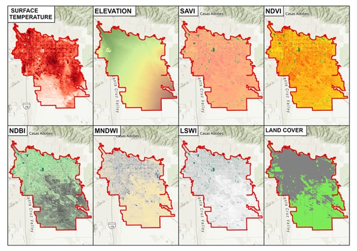
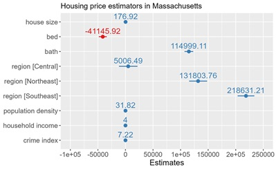
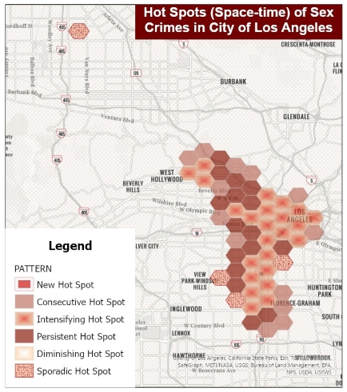
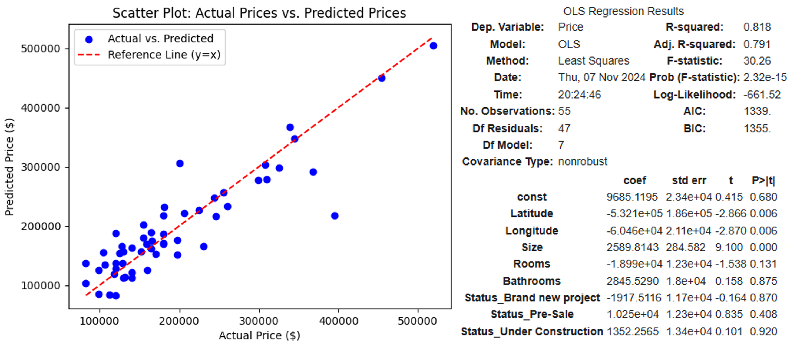

# Spatial Data Scientist

## Abstract
With a strong foundation in geospatial sciences and advanced data analytics, this portfolio highlights my technical experience. My studies are a MSc. in Data Analytics and CSS, complementing my MSc. in Geographic Information Systems and my Bs. in Geomatics Engineering. My professional experience includes diverse roles such as a Project Engineer and a Project Manager working in Projects related to GIS and innovative solutions.  I have also contributed as a professor teaching GIS and Cartography courses.

For more information, see [Resume](https://drive.google.com/file/d/195Osi9_khLA5QBt5cUesHaEt9bcvDIPN/view?usp=sharing)

## Projects

### Geospatial Data Extraction and Integration for Correlation Analysis in Tucson, Arizona
- **Objective:** Develop an efficient extraction and integration workflow for geospatial datasets, including LANDSAT imagery analysis to obtain derived indices (NDVI, SAVI, NBDI, MNDWI), SRTM elevation data, and land cover information. This dataset supported advanced correlation analysis with machine learning, focusing on environmental variables to urban planning and sustainability studies.
- **Tools Used:** ArcGIS Pro, Spatial Analysis, Imagery Analysis, ArcPy, Python
- **GitHub Repository:** [https://github.com/eiig26/extraction-imagery](https://github.com/eiig26/extraction-imagery)
- Main Findings:
 

### From Data to Decisions: Understanding the Housing Prices determinants in Massachusetts
- **Objective:** Examine the impact of various factors on housing prices in Massachusetts using regression models, analyzing house features (number of bedrooms, bathrooms, house size, lot size), location, median household income, population density, and crime index.
- **Tools Used:** R (Tidyverse, ggplot2, linear model)
- **GitHub Repository:** [https://github.com/eiig26/housing_predictions_603](https://github.com/eiig26/housing_predictions_603)
- Main Findings:
  

### Analysis of Sexual Crime Trends in the Los Angeles: Spatio-Temporal perspective with GIS
- **Objective:** Detect and explore sexual crimes trends in Los Angeles using official LAPD data and ArcGIS Platform to incorporate data transformation and a range of visualizations, including 3D and space-time techniques like the Space Time Cube and Hot Spot Analysis, to study relationships between crime incidents, time, and spatial patterns.
- **Tools Used:** ArcGIS Pro, ArcGIS Notebooks, ArcPy, Python, Spatial Analysis, ArcGIS Online
- **StoryMap:** [https://storymaps.arcgis.com/stories/6e4a083720b54f8b978e928c78c608c9](https://storymaps.arcgis.com/stories/6e4a083720b54f8b978e928c78c608c9)
- Main Findings:
  

### From Web Scraping to Machine Learning: Understanding Panama City's Real Estate with Python.
-	**Objective:** Analyze the real estate market in Panama City using data from ACOBIR's website. Initially web scraping apartment listings, and then exploring the factors influencing property prices through data cleaning, visualization, and predictive modeling.
-	**Tools Used:** Python (BeautifulSoup, Pandas, Folium, Seaborn, Matplotlib, Scikit-learn)
-	**GitHub Repository:** [https://github.com/eiig26/realestate_panamacity](https://github.com/eiig26/realestate_panamacity)
- Main Findings:
  

